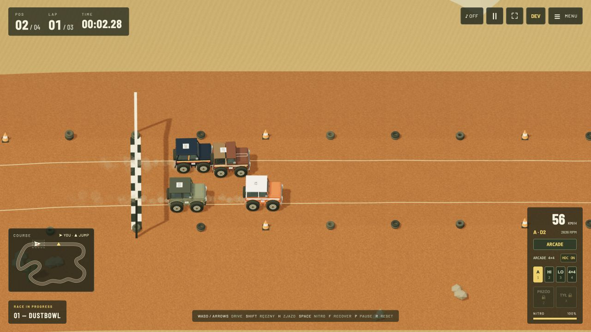
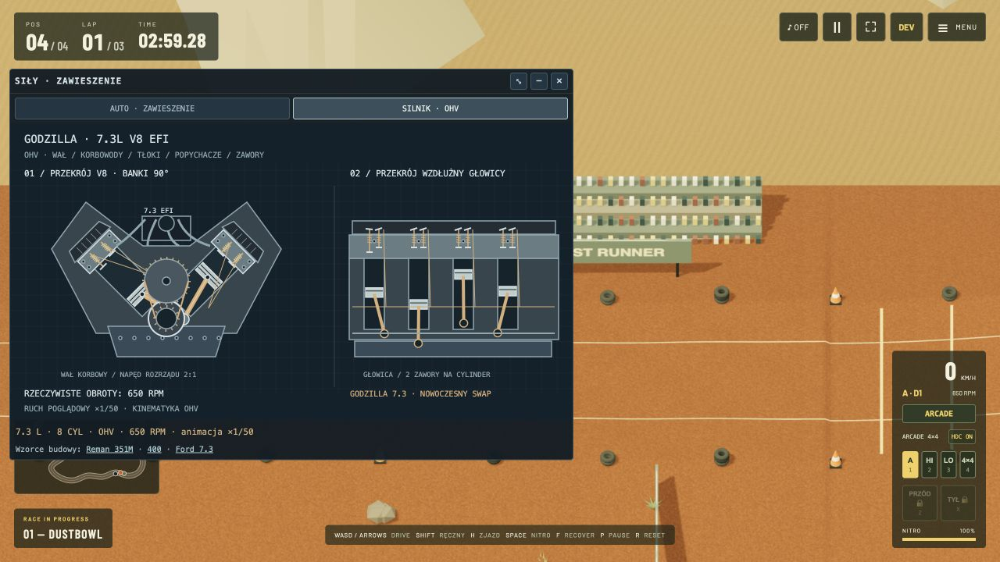

# Dust Runner

**Small trucks. Big dirt energy.** A browser 4×4 arcade racer with dune jumps, articulated suspension, engine-specific gearboxes and a whole desert to explore.

**[PLAY NOW ↗](https://xsub.github.io/DustRunner/)** · [Explore a shared random desert](https://xsub.github.io/DustRunner/?mode=desert&dunes=random&seed=20261020) · [Engine & sound notes](ENGINE_NOTES.md)


*An actual Free Ride jump in Burzowe Grzbiety, seed 1947. Captured in-game with the default arcade gravity; no staged vehicle poses.*

## Pick your playground

- **Race:** 16 dirt circuits, each with four mirror layouts — 64 configurations. Every circuit has **4–10 ramps in three height classes** (default 0.65 / 2.075 / 3.5 m above the local road), with room for takeoff and landing. Race three AI opponents through ramps, split landings, whoops, banks and winding terrain.
- **Free Ride:** a 1,200 × 600 m desert with three dune styles: storm ridges, giant star dunes and a seeded random expedition. Climb, jump and find your own route. Four-wheel trails follow the terrain in Free Ride and races, including all AI cars, with tread impressions and stronger marks under braking or sideways slip.
- **Choose your truck:** seven selectable procedural SUV bodies inspired by classic Bronco® shapes, from emerald/ivory Heritage and open-top crawlers to brown Classic ’78 and the Godzilla ’78 restomod.
- **Build your drivetrain:** 12 inline-six and V8 profiles, including the 7.3 L Godzilla swap. Each engine has a fixed gearbox profile; choose arcade shifting, full automatic or sequential manual control.
- **Drive it like a 4×4:** HI/LO ranges, crawler mode, front/rear differential locks, hill-descent control (independent of the Arcade/Classic steering profile), progressive braking and optional held-angle steering.
- **Explore beyond the track:** broad irregular sandy hills, hollows and scattered small dunes share their visible geometry with collision. Fine sand grain replaces repetitive surface stripes.
- **Feel the terrain:** four spring/damper wheel contacts, axle articulation, tire slip, mass distribution, jumps, collisions and rollovers. Recovery searches for a safe, flatter footprint.
- **Keep driving after the finish:** medal-colored confetti celebrates the result while you continue victory laps. End the race when ready, or stop for the result screen.



*Four-car racing on Dustbowl, with Classic ’78 Copper as the player truck.*

## Optional “Ruffles” sand

In **Menu → PIASEK · OPCJONALNE FALE „RUFFLES”**, enable regular waves, set their spacing (16–120 m) and trough-to-crest height (0–3 m), then choose **ZASTOSUJ FALE · RESTART**. The option adds visible bands and actual terrain waves in races and Free Ride; racing shoulders and the Free Ride spawn remain clear. It is off by default, preserving the irregular desert hills. Applying restarts the current session.

The same controls live in **DEV → Piasek · Ruffles**, are included in tuning JSON/presets and save in browser-local active settings. Shared desert links carry the seed/variant; use the same wave settings to reproduce optional Ruffles relief.

## Generate a race circuit

Open **Menu → WYŚCIG → GENERATOR LOSOWYCH TRAS** below the circuit cards. Use **LOSUJ NOWĄ TRASĘ** for a fresh layout, or enter an unsigned 32-bit seed and choose **GENERUJ Z ZIARNA**. The generated circuit appears as a selected seventeenth card; start the race with **START RACE**. It has 4–10 ramps in all three heights, rolling terrain and a straight opening runway. Both mirror toggles work on generated circuits, too. The most recently entered seed is kept in browser storage; regenerate it to return to that layout.

The same seed and simulation tuning recreate the same track. Generating replaces the temporary random circuit, while keeping the 16 presets available. Ramp locations are chosen for clear spacing and gentler approach/landing direction changes; the main canyon jump keeps its split landing. Small triangles on the minimap identify ramp takeoffs.

## Share your desert

Open **Menu → FREE RIDE → LOSOWA EKSPEDYCJA**, generate a landscape, then press **UDOSTĘPNIJ TĘ PUSTYNIĘ · KOPIUJ ZAPROSZENIE**. Paste the invitation into a message: the public game link contains the dune variant and exact generator seed, so your friend can load the same terrain. If clipboard access is unavailable, the game selects the invitation for manual copying.

Shared links recreate the landscape. Personal tuning, upgrades and local progress stay in your browser.

## Under the hood

| Technology | What it does |
| --- | --- |
| **Three.js / WebGL** | Procedural vehicles and scenery, lighting, paint and chrome, instanced vegetation and markers, chunked terrain and visibility culling. Adaptive rendering aims to preserve smooth play. |
| **Rapier 3D / WebAssembly** | Fixed 120 Hz rigid-body simulation, raycast wheel contacts, spring/damper suspension, impacts and rollovers. Rendered terrain and collision surfaces share their triangle geometry. |
| **Custom powertrain model** | Engine torque maps, RPM/load response, transmission ratios, shifting, low range and differential-lock behavior feed vehicle forces and sound. |
| **Web Audio / AudioWorklet** | RPM-driven sustained engine loops, load/overrun mixing and procedural cylinder-pulse synthesis. Recording sources and licenses are in the [audio credits](public/audio/CREDITS.md). |
| **Canvas 2D + HTML/CSS** | Minimap, telemetry, animated vehicle/engine cutaways, HUD, menus and confetti. |
| **Vanilla JavaScript + Vite** | Modular game code and a static production build. Node’s test runner checks physics, terrain, drivetrain, racing rules and UI support logic. |
| **GitHub Actions + GitHub Pages** | Tests, build and deployment on pushes to `main`. No game server or account is needed. |

The target is **60 FPS or better**, with physics and rendering budgets focused on nearby gameplay. Actual performance depends on the device, browser and scene. The game uses visible-prop motion quotas and shared/instanced geometry to control CPU and draw-call costs.

This is an arcade simulation: engine curves, loaded masses and performance are game calibrations, rather than factory-certified dynamometer results. Live-axle articulation is an approximation, not a complete mechanical linkage simulation. See [engine model, gearbox choices and sources](ENGINE_NOTES.md).



*The live engine view follows actual engine RPM, with slowed mechanical animation for readability: crankshaft, pistons, connecting rods, camshaft and valves.*

## Controls

| Key | Action |
| --- | --- |
| W / ↑ | Accelerate |
| S / ↓ | Progressive brake; hold after stopping for reverse in automatic modes |
| A / D or ← / → | Steer |
| C | Center steering |
| Space | Rechargeable nitro |
| Shift / HB | Momentary rear handbrake while held. |
| , (comma) / handbrake HUD | Toggle the parking brake immediately. |
| . (period) / engine HUD | Start or stop the engine; stopping requires a stationary, grounded truck. |
| 1 / 2 / 3 / 4 | AUTO / HI / LO / 4×4 crawler |
| Z / X | Front / rear differential lock in crawler mode |
| H | Hill-descent control |
| Q / E | Downshift / upshift in full manual mode |
| N | Neutral in full manual mode; shift below neutral for reverse |
| F | Recover to safe terrain |
| P / Escape | Pause |
| R | Reset session |
| Enter | Start / race again |

Touch controls are available on touch devices. The compact handbrake HUD shows its latched state; pausing preserves a latched brake, while recovery or reset releases it. Engines start running by default. Ignition adds a timed starter, shutdown, zero torque/RPM when off, and matching sound transitions. Coasting keeps the engine audible with reduced load. Soft pooled exhaust particles originate at the rendered tailpipes, follow vehicle attitude, and respond to throttle, gear changes and startup. Enable sound with **♪ ON** or in the menu. The menu also contains truck selection, engine hot-swaps, the five-generation history guide, tuning and display options.

## Tuning and telemetry

Open **DEV** to adjust simulation and camera parameters, save named “tunning” presets, or copy/import JSON. Drag, collapse or hide the FPS window and the vehicle diagnostics panel. Vehicle cutaways visualize wheel travel, steering, wheel speeds, body attitude and forces; the engine tab shows an OHV schematic.

Presets and progress use **localStorage**, on this browser and site only. Saving a tune does not write to GitHub. Clearing site data removes local saves; exported JSON is the portable backup. Localhost and GitHub Pages have separate storage.

## Run locally

Requires Node.js **20.19+ or 22.12+**.

```sh
npm install
npm run dev
```

Open the address printed by Vite. Useful commands:

```sh
npm test                           # automated checks
npm run build                     # static site → dist/
npm run preview                   # preview the production build
npm run build -- --base=/DustRunner/ # GitHub Pages repository path
```

Pushes to `main` run [.github/workflows/pages.yml](.github/workflows/pages.yml), test the code and publish the built site. Longer implementation history and tuning details are preserved in [development notes](docs/DEVELOPMENT.md).

## Credits and rights

**© 2026 PUFFY CLOUDS — USING AI TECHNOLOGY.** Original game code and procedural artwork are credited to Puffy Clouds.

**Ford® and Bronco® are registered trademarks of Ford Motor Company.** Ford names, emblems and vehicle marks belong to Ford Motor Company. Copyright in Ford reference materials remains with Ford Motor Company or its licensors; this project claims no rights to those materials. Dust Runner is an independent project and is not affiliated with, sponsored by, or endorsed by Ford Motor Company.

See [rights and third-party notices](NOTICE.md) and [engine recording credits](public/audio/CREDITS.md). Screenshots above show actual gameplay from this project.
