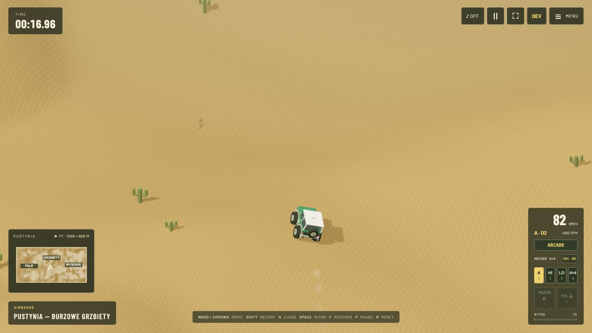

# Dust Runner

**Relaksująca podróż przez świat miniaturowych wyścigów pustynnych i swobodnego błądzenia po pustkowiach.** Wybierasz mały, stylizowany model z rodziny **Ford Bronco®** i ruszasz: na wyścig, podjazd, skok z wydmy albo po prostu przed siebie.

To gra pisana dla siebie, z zajawki do terenówek, fizyki i dłubania w szczegółach. Dla osób, które lubią miniaturowe samochody, odkrywanie terenu i eksperymentowanie z napędem 4×4. Lekka forma i tryby Arcade spotykają się tu z rozbudowaną symulacją jazdy w fizycznym świecie 3D.

**[ZAGRAJ W PRZEGLĄDARCE ↗](https://xsub.github.io/DustRunner/)** · **[OBEJRZYJ GARAŻ 3D](https://xsub.github.io/DustRunner/garage.html)** · [Przykładowa losowa pustynia](https://xsub.github.io/DustRunner/?mode=desert&dunes=random&seed=20261020)



## Co tu znajdziesz

- **Wyścigi i eksplorację:** 16 tras, lustrzane warianty, generator kolejnych i rywali AI o pięciu poziomach umiejętności. Obok wyścigów — swobodna jazda po pustyni bez limitu czasu.
- **Zróżnicowany teren:** 2,88 km² pustyni, koleiny, wydmy, skalne podjazdy i pary ramp do skoku i lądowania. Różne generatory oraz osobny tryb **Trudne wydmy**.
- **Garaż Bronco:** 20 proceduralnych modeli i 12 profili silników, w tym Godzilla 7.3 V8. Indywidualne masy, większe koła i lift wpływają na prowadzenie.
- **Napęd 4×4:** automat domyślnie, ręczna zmiana biegów, skrzynie przypisane do silników, HI/LO, pełzanie, blokady obu mostów, HDC i ręczny. Prowadzenie Arcade lub Classic.
- **Odczuwalną fizykę:** pracę zawieszenia i kół, przyczepność, poślizg, rozkład masy, skoki, lądowania, zderzenia i wywrotki. Ślady opon, kurz, wydech i dźwięk reagują na jazdę.
- **Wspólne odkrywanie:** generuj pustynie i kopiuj zaproszenia z linkiem, aby znajomi trafili na ten sam teren.
- **Mnóstwo detali:** konfigurowalne zegary, kompas, nachylenie zbocza, animowane przekroje silnika i zawieszenia, telemetrię i strojenie fizyki. Klawiaturę na komputerze, dotyk i gesty kamery na telefonie.

## Jak zacząć

Otwórz grę, wybierz wyścig lub **Free Ride** i jedź. Menu pozwala zmienić samochód, silnik, teren, przeciwników i ustawienia. Dźwięk włączysz ikoną głośnika. Na telefonie wygodnie gra się poziomo; przeciąganie po terenie obraca kamerę, a dwa palce sterują zoomem.

[Pełna lista skrótów](docs/controls.md) · [Sterowanie mobilne](docs/mobile-controls.md)

## Jak to działa

**Three.js / WebGL** rysuje proceduralny świat, **Rapier 3D / WebAssembly** liczy fizykę przy 120 Hz, a własny model napędu przekłada pracę silnika i skrzyni na siły na kołach. Widoczny teren i kontakt korzystają ze wspólnej geometrii. Pozostały stack: **JavaScript, Web Audio / AudioWorklet, HTML/CSS, Canvas i Vite**; testy i publikacja przez **GitHub Actions / Pages**.

To symulacja nastawiona na frajdę z jazdy: masy customów, charakterystyki silników i część mechaniki są kalibracjami gry, a nie danymi homologacyjnymi. Postęp i ustawienia zapisują się lokalnie w przeglądarce; link do pustyni odtwarza teren, nie przenosi osobistych ustawień.

## Uruchomienie lokalne

Node.js 22.12+:

```sh
npm install
npm run dev
npm test
npm run build -- --base=/DustRunner/
```

Szczegóły: [silniki i źródła](ENGINE_NOTES.md) · [modele i fizyka](docs/vehicle-dynamics.md) · [sterowanie mobilne](docs/mobile-controls.md) · [strojenie i rozwój](docs/DEVELOPMENT.md) · [protokół pomiarów wydajności](docs/performance-benchmark.md).

## Autorstwo i marki

**© 2026 Puffy Clouds · Created by Puffy Clouds using AI.**

**Ford® i Bronco® są znakami towarowymi Ford Motor Company.** Dust Runner jest niezależnym projektem, niepowiązanym z Fordem i przez niego niesponsorowanym. Prawa do materiałów referencyjnych należą do ich właścicieli. [Informacje o prawach i komponentach](NOTICE.md) · [Źródła i licencje nagrań](public/audio/CREDITS.md).
