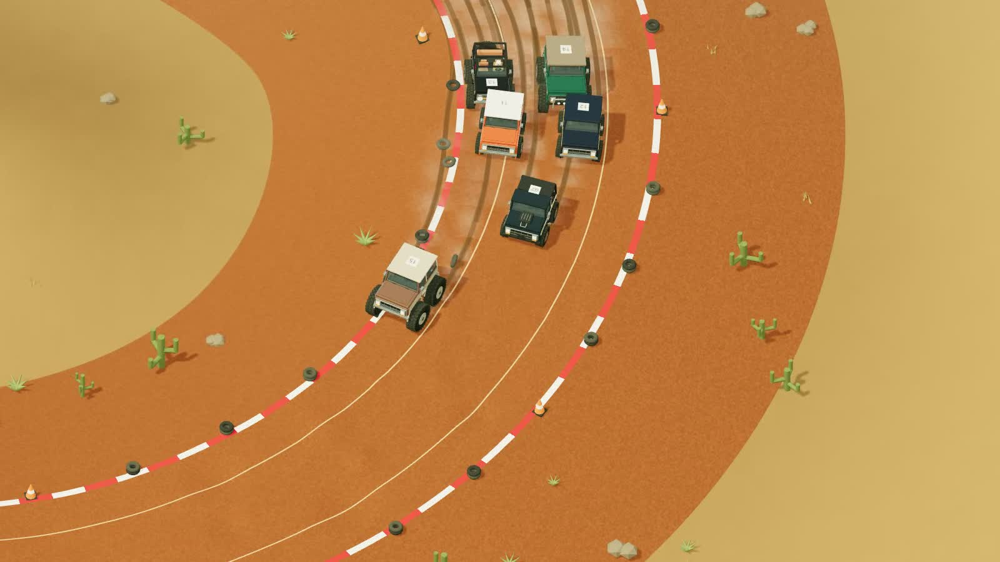
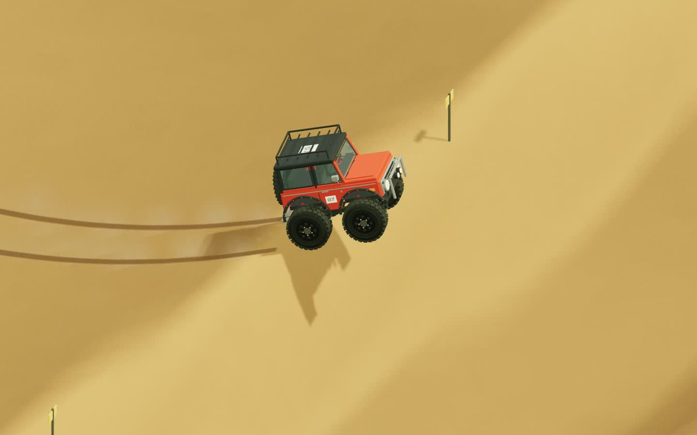
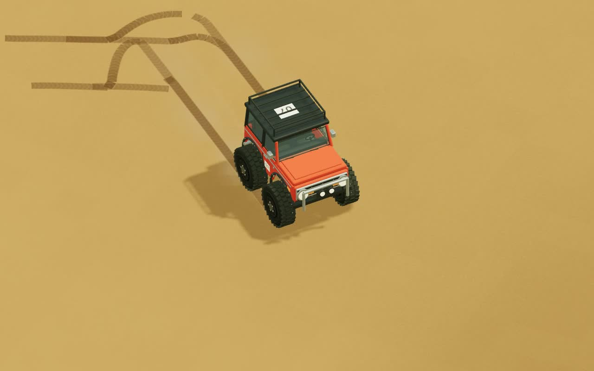
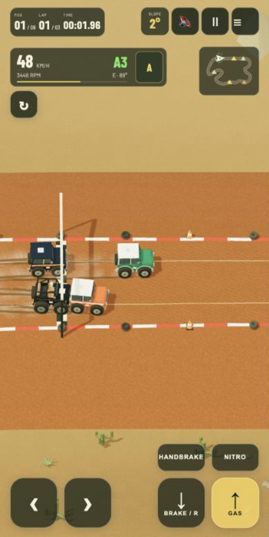

# Dust Runner · v1.1

**A relaxing journey through miniature desert races and open wilderness.** Pick a small, stylized **Ford Bronco®** and head out for a race, a climb, a dune jump, or a drive with no destination.

A personal passion project for people who enjoy tiny trucks, off-road exploration, and experimenting with 4×4 drivetrains. Accessible Arcade handling meets a detailed 3D vehicle simulation, with plenty of room to tinker.

**[PLAY IN YOUR BROWSER ↗](https://xsub.github.io/DustRunner/)** · **[EXPLORE THE 3D GARAGE](https://xsub.github.io/DustRunner/garage.html)** · [Try a seeded desert](https://xsub.github.io/DustRunner/?mode=desert&dunes=random&seed=20261020)



**[▶ Gameplay videos and gallery](https://xsub.github.io/DustRunner/gallery.html)** · [Race pack · MP4](https://xsub.github.io/DustRunner/media/race-pack.mp4) · [Dune jump · MP4](https://xsub.github.io/DustRunner/media/dune-jump.mp4)

| Sideways dune jump | Tire tracks after landing |
| --- | --- |
|  |  |

<details>
<summary>Mobile view — touch controls, automatic transmission, and minimap</summary>



Browser-emulated phone layout, 390 × 777. All screenshots and clips come from the running game; cinematic clips have the HUD hidden.

</details>

## What's new in 1.1

- **A clearer Pit Stop:** Play, Tracks & terrain, Vehicles, Simulation, Stats, Bronco history, and Community. Player/Developer and Performance switches keep advanced tools within reach.
- **English-first interface:** centralized translations, ready for additional languages. English is the only language currently shipped.
- **Compact instruments:** choose Rally Six, rectangular, round, or a vehicle-matched style. Transmission mode, front/rear differential locks, and HDC share one row.
- Desktop and mobile layout checks, including longer translated text. Community remains a planned feature; desert invitation links already work.

## Explore and drive

- **Racing and free ride:** 16 tracks, mirrored variants, a random track generator, and 0–11 AI rivals across five skill levels. Explore the desert without a time limit.
- **Varied terrain:** 2.88 km² of desert, tire ruts, dunes, rock climbs, wider bidirectional ramp pairs with cross approaches, a four-way pyramid, and low suspension rollers. Multiple generators include dense **Jumpy Dunes** for repeated jumps and a separate **Hard Dunes** mode.
- **The Bronco garage:** 20 procedural vehicle models and 12 engine profiles, including the Godzilla 7.3 V8. Model-specific mass, larger tires, and suspension lifts affect handling.
- **4×4 controls:** automatic transmission by default, manual shifting, engine-matched gearboxes, HI/LO transfer ranges, crawl mode, front/rear differential locks, HDC, and a parking brake. Choose Arcade or Classic handling.
- **Responsive physics:** suspension travel, wheel contact, grip, sliding, weight distribution, jumps, landings, collisions, and rollovers. Tire tracks, dust, exhaust, and sound respond to driving.
- **Share an expedition:** copy a seeded desert invitation, optionally including the vehicle, its settings, starting position, and the last 100 m of your route.
- **Details to discover:** configurable gauges, a compass, terrain slope, animated engine and suspension cutaways, telemetry, and physics tuning. Keyboard controls on desktop; touch controls and camera gestures on phones.

## Get started

Open the game, choose a race or **Free Ride**, and drive. Use the Pit Stop to select a truck, engine, terrain, rivals, and simulation settings. Enable audio with the sound button. Landscape orientation works best on phones: drag the terrain to orbit the camera and pinch to zoom.

[Keyboard shortcuts](docs/controls.md) · [Mobile controls](docs/mobile-controls.md)

## Technology

**Three.js / WebGL** renders the procedural world. **Rapier 3D / WebAssembly** runs physics at 120 Hz, while a custom powertrain model turns engine and gearbox behavior into wheel forces. Rendering and terrain contact share the terrain geometry. The rest of the stack is **JavaScript, Web Audio / AudioWorklet, HTML/CSS, Canvas, and Vite**, with tests and deployment through **GitHub Actions / Pages**.

The simulation prioritizes enjoyable driving. Custom vehicle masses, engine characteristics, and some mechanics are game calibrations rather than certified vehicle specifications. Progress and preferences stay in browser storage; you choose separately which data to include in a shared invitation.

## Run locally

Node.js 22.12+:

```sh
npm install
npm run dev
npm test
npm run build -- --base=/DustRunner/
```

Further reading: [desert sharing](docs/desert-sharing.md) · [engines and sources](ENGINE_NOTES.md) · [vehicle dynamics](docs/vehicle-dynamics.md) · [Jumpy Dunes and ramp design](docs/jumpy-dunes.md) · [mobile controls](docs/mobile-controls.md) · [localization](docs/internationalization.md) · [menu UX review](docs/ux/README.md) · [development and tuning](docs/DEVELOPMENT.md) · [performance benchmark protocol](docs/performance-benchmark.md).

## Credits and trademarks

**© 2026 Puffy Clouds · Created by Puffy Clouds using AI.**

**Ford® and Bronco® are registered trademarks of Ford Motor Company.** Dust Runner is an independent project, not affiliated with, sponsored by, or endorsed by Ford. Reference materials belong to their respective owners. [Copyright and third-party notices](NOTICE.md) · [Audio sources and licenses](public/audio/CREDITS.md).
