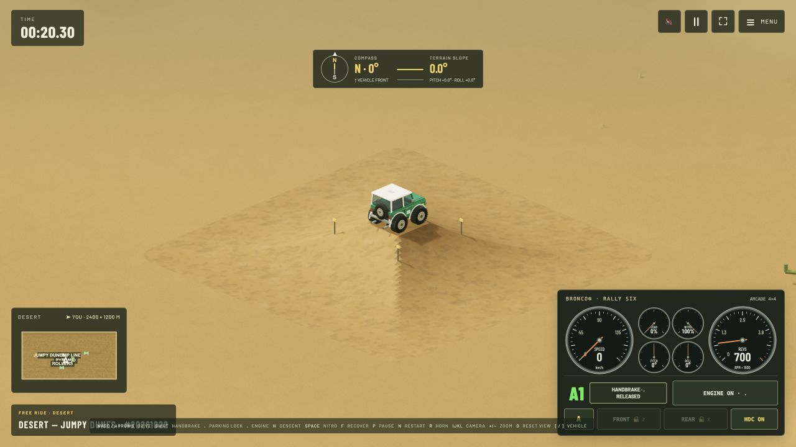
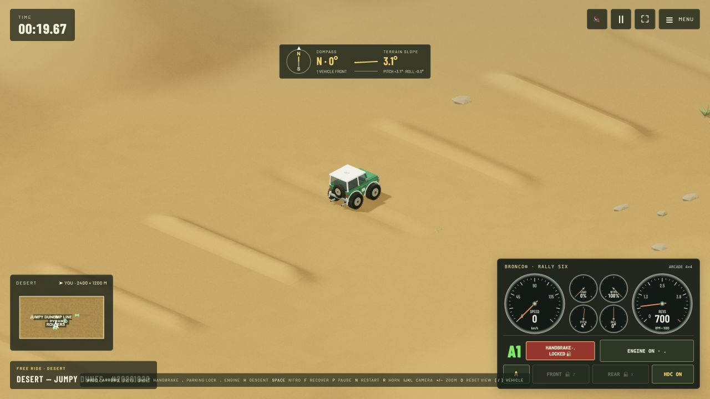
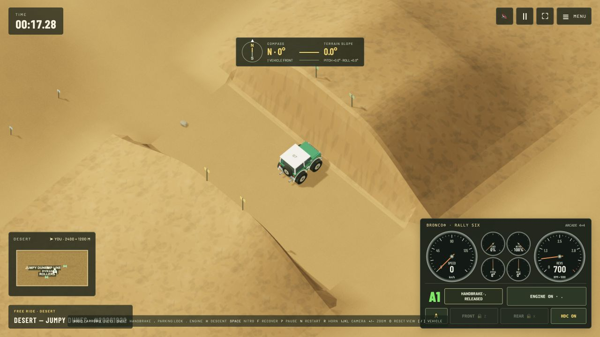

# Jumpy Dunes and rebuilt jump pairs

Choose **Free Ride → Tracks & terrain → JUMPY DUNES**, or open a link with `?mode=desert&dunes=jumpy&seed=20261022`. Seeds and the optional vehicle/settings/position/route invitation payload work as with other deserts.

The 2400 × 1200 m field has dunes spaced about 30 m apart. Heights range from approximately 0.84 m (half the stock wheel diameter) to 8 m (roughly two to three stock vehicle heights). A representative 90 × 90 m board window contains around six to nine substantial crests; the visible number changes with camera angle, zoom, aspect ratio and position. Short windward approaches, rounded peaks and shorter lee faces make jumping frequent.

A clear northbound line from the starting basin uses a calibrated sequence of 3 m dunes. This rhythm is deliberately preserved across seeds so the generator cannot replace its entry route with an impassable hill. The surrounding dunes vary in height and placement. Large rock formations are omitted in this variant, and scenery is excluded from the entry line. Hard Dunes retains its historical terrain.

## Wider, multidirectional ramps

The six sand jumps have 8–10 m decks, and the three rock pairs have 8 m decks. Broad, graded side banks allow cross jumps. Unpaired sand ramps have matching front and rear faces; paired ramps can be driven from either end. Blue flags frame the cross approaches, while yellow and green flags distinguish the two longitudinal banks. Sand takeoffs are 5.4–16.5 m high; rock takeoffs are 7.2, 10.5 and 15 m high, three times their earlier heights.

The lip-to-landing separation is 15.3 m for small/medium pairs and 19.2 m for expert pairs: about 3–3.8 stock car lengths (the stock visual model measures approximately 5.08 m). Clear acceleration corridors extend 260 m beyond both ends. Landing tails have a smooth ground transition so they also work as return approaches. Landing faces use a curved flight envelope calibrated with actual 120 Hz Rapier drives, then round into the ground. Geometry stays fixed when the player changes gravity or vehicle tuning; different engines, approach speeds and suspension settings produce different outcomes.

Small/medium pairs target the stock 302 at roughly 85–95 km/h at takeoff. The tallest pairs target a strong V8, around 125 km/h. A slow 170 can fall short of these engineered gaps; full-throttle Godzilla can overshoot smaller landings. Return jumps and taller cross jumps suit a strong V8; pedal control still matters. These are not automatic jumps or assisted landings: no vehicle impulse, trajectory override or hidden speed clamp is applied.

## Four-way pyramid and low rollers

A sandstone pyramid northwest of the start, at **(-85, 130)**, has four equal 14 m banks, a 4 × 4 m flat cap and a 3.2 m peak. It works as a skatepark-style transfer in all four directions. Its surrounding approach area is clear of scenery, and the map labels it **PYRAMID**.

Over 1,000 seeded elongated humps and shallow depressions add local suspension work outside the protected jump corridors. Raised rollers are 25–85 cm high, with shallow negative grooves mixed in. A separate **ROLLERS** practice strip at x=-165, z=158–270 has eight 24 m long speed bumps and dips, spaced 16 m apart. Hard Dunes retains its historical terrain.

## Contact detail and verification

The background retains its 2.5 m grid. Cells around narrow ramp decks are locally refined to 0.5 m, using the same triangles for rendering and physics. Boundary vertices meet adjacent coarse edges, and the height sampler follows the refined triangles. The default desert has about 1.21 million terrain triangles versus the previous 0.92 million; the whole map is not subdivided.

Regression tests cover density, seed reproduction and sharing, repeated physical jumps with 170/302 engines across three seeds, recovery-compatible ground sampling, ramp dimensions and exact contact heights. Tests also drive a stock 302 across the pyramid from all four directions, exercise the roller strip suspension, and drive all three rock pairs backwards and across from both sides with a strong V8. Matched-engine forward ramp tests require continued driving without a rollover and less than 8 m/s normal approach velocity at first landing contact. This measures impact perpendicular to the landing face, rather than raw vertical speed.

For diagnostic trajectories:

```sh
node scripts/check-desert-jumps.mjs jumpy 20261022
node scripts/check-desert-jumps.mjs ridges 1947
```

The diagnostic intentionally also tries underpowered and excessive-speed combinations. Those results are observations, not a promise that every engine can clear every gap. Physical phone performance remains device-dependent; these checks do not constitute a full-screen performance campaign.

## In-game views

| Four-way pyramid | Low roller strip |
| --- | --- |
|  |  |


