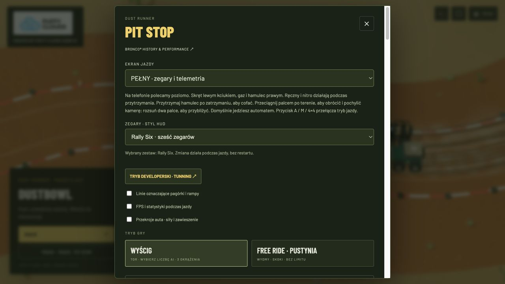
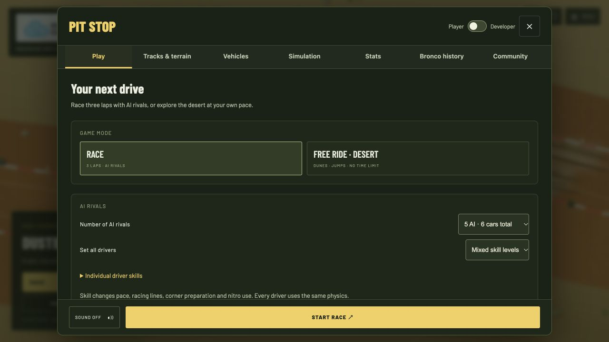
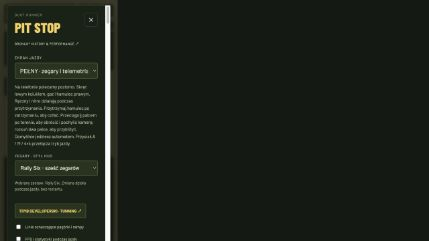
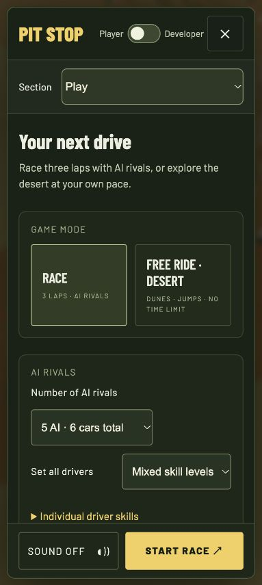

# Pit stop UX and English migration review

Feature branch: `codex/english-i18n-menu-ux`. Baseline: `9e38cab` (22 October 2026). Released on `main` and GitHub Pages as v1.1.0 on 22 October 2026.

## What changed

A single long Pit Stop form became seven sections. Desktop uses keyboard-accessible tabs (Left/Right, Home/End); narrow screens use one native section selector. Heading, navigation, close and primary drive action stay visible while the content scrolls.

| Section | Controls |
| --- | --- |
| Play | Race/free ride, number and skills of rivals; collapsible screen and control preferences |
| Tracks & terrain | Circuits, mirrors, seeded generators, desert types, invitations and optional sand waves |
| Vehicles | Searchable model cards, 3D garage, engine swap, recordings and upgrades |
| Simulation | Handling, steering, transmission, ranges, locks and HDC; developer physics tuning |
| Stats | Performance and car-inspector switches; full benchmark in Developer view |
| Bronco history | Existing historical guide, engine comparisons, sources and legal notices |
| Community | Explicit Coming soon; points to the already working desert invitations |

Player/Developer is a real switch. It only reveals controls; it does not rebuild the simulation, discard drafts or alter tuning. Switching sections moves no controls and recreates no handlers. Fresh installs start with a clean HUD; saved overlay preferences are respected. Closing the tuning dialog without applying returns to the same menu section. Pending rival changes are clearly shown on the primary action: starting commits the draft, with an explicit restart label for an active race. Existing generated preset names are displayed in English; custom user names and stored documents are preserved.

English strings cover the game, HUD, canvas diagnostics, errors, sharing, finish flow, developer panel, history, garage and media gallery. No Polish locale is shipped. See [adding a language](../internationalization.md).

## Baseline and comparison

The original mixed interface is preserved in Git at the baseline commit, plus screenshots and measurements in `before/`. The desktop menu previously measured **700 × 692 px with 5375 px of scroll content** at 1280 × 720.

The new desktop dialog is **1040 × 692 px**, with 485 px of scrollable content height. At default settings the Play section has 716 px of content; Stats, History and Community fit the content region without scrolling. Longer vehicle, track and simulation sections retain scrolling. The primary drive action remains visible throughout.

| Before | After |
| --- | --- |
|  |  |
|  |  |

Additional captures: [vehicles](after/desktop-vehicles.png), [stats](after/desktop-stats.png), [developer tuning](after/developer-tuning.png), [desktop HUD](after/desktop-hud.png), [mobile HUD](after/mobile-hud.png), [landscape HUD](after/mobile-landscape-hud.png), [desert sharing](after/mobile-desert.png), [history](after/history.png), [garage](after/garage.png).

## Checks performed

- All seven sections at desktop 1280 × 720, portrait 429 × 855 and 320 × 709, and landscape 852 × 392. Measurements are saved as JSON in `after/`; no horizontal overflow of the content region or tested controls was found.
- A review-only expanded-English catalogue increased word lengths by roughly 40%. Desktop and small-phone sections retained wrapping without horizontal overflow or clipped button contents. The temporary catalogue was removed; only English remains registered. [Measurements](after/expanded-text-audit.json), [stress screenshot](after/expanded-text-test.png).
- Search filtered twenty models to the matching Monster model; singular/plural count labels were checked.
- An unapplied seven-opponent draft survived tab changes, Developer switching and a round trip through tuning. Editing gravity to 18 and closing without applying left the actual setting at 20.
- The primary action committed a seven-rival draft and the HUD showed eight cars; changing back to five rivals restored six cars. Restart wording was verified during an active session.
- Automatic driving and both mobile orientations were exercised; runtime errors were checked. History, developer controls and gallery/garage language were reviewed.
- All 361 unit/behavioral tests pass and the production build succeeds on the feature branch. These checks do not constitute a physical-device performance benchmark.

Phone screenshots are browser emulation, not physical iPhone/Android captures. Archived media captured before this branch remains historical content; the gallery's mobile HUD image is refreshed to English.
